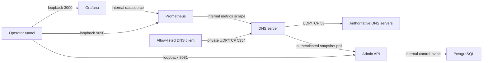

# Platform Architecture

The platform separates the DNS data plane from the operational entry points.

```text
DNS clients
    |
    v
dns-server  --->  dns-core  --->  authoritative DNS servers
    |
    +-- admission control, configuration, health, metrics
    |
    +-- private /metrics --> Prometheus --> Grafana

Platform operators
    |
    | Authorization: Bearer <opaque-token>
    v
admin-api  --->  dns-core
    |
    +-- stateless authentication, RBAC, policy-control API, Flyway migrations
    |
    v
admin database (policy records, admin identities, token hashes)
    +-- H2 for local development; PostgreSQL for deployment

integration-tests
    +-- exercises dns-server and dns-core together over loopback sockets
```

`dns-core` owns DNS names, messages, cache entries, recursive resolution, and
upstream transport. It must not depend on `dns-server`, a web framework, a
database, or a deployment tool. `dns-server` owns process lifecycle plus UDP
and TCP client transports and depends on `dns-core`.

The DNS process has a second operational HTTP listener for
Prometheus-format metrics. It derives a fixed set of counters and a successful
handling-duration sum/count from the existing thread-safe `ServerMetrics`
snapshot. The listener defaults to loopback-only access and is independent of
the DNS request path; it does not add query-time I/O, database calls, or labels
containing DNS names, client addresses, tokens, or exception messages. The
readiness endpoint remains `/health`, while metrics use `/metrics`.

The monitoring stack is intentionally outside the DNS
request path. In Compose, Prometheus scrapes only `dns-server:9091/metrics`
over a separate `observability` network. The metrics port is not published to
the host; the listener is reachable by trusted containers on any network
attached to DNS, including its egress and policy-distribution networks. Those
networks must therefore remain tightly scoped. Prometheus and Grafana UIs are
mapped only to host loopback. Grafana uses a versioned, provisioned DNS operations dashboard, and
Prometheus evaluates versioned alert rules. No Alertmanager or notification
receiver is included yet, so monitoring failure cannot delay DNS traffic and
alerts remain local to the Prometheus UI.

The Admin API is deliberately not a metrics scrape target. Its security model
permits anonymous health only; adding a scrape endpoint would require a
least-privilege credential rather than making management metrics public.

`admin-api` is a separate Spring Boot management-plane module. It depends on
`dns-core`, while `dns-core` depends on neither process. `dns-server` polls one
authenticated snapshot endpoint in a background
thread, but the Admin API and its database never sit on the DNS query path.

The management plane uses stateless opaque Bearer tokens.
An authenticated principal has one or more persisted roles: `VIEWER` may read
operational and policy data, `POLICY_EDITOR` may also mutate policies, and
`ADMIN` may manage administrators and token lifecycle. The raw token is only
returned at issuance; the database stores its hash and metadata, allowing
immediate revocation without storing recoverable credentials.

`GET /actuator/health` is the sole anonymous endpoint and returns minimal probe
status. All other endpoints require a valid Bearer token and an explicitly
authorized role. Any unlisted route, including unlisted actuator routes, is
denied rather than becoming authenticated merely because it exists.

Docker Compose packages the services for local operation. PostgreSQL and
the `admin-api` share a dedicated `control-plane` network; PostgreSQL has no
published host port. The Admin API listens on all interfaces inside its
container so Docker can probe it, but Compose publishes it only to
`127.0.0.1` on the host. The `dns-server` is deliberately separate from the
control-plane network because recursive resolution needs outbound connectivity
to authoritative DNS servers. A separate internal network is shared
only by DNS and the Admin API for authenticated snapshot polling; DNS still has
no database access and no management I/O on its query threads.

The Compose configuration consumes a local ignored environment file for
database and bootstrap credentials. It is a development/deployment baseline,
not a production secret-management solution: a shared environment should use
TLS, a platform secret store, controlled ingress, and a managed PostgreSQL
service or equivalent backup/restore plan.

The CI and supply-chain boundary is outside every runtime
request path. GitHub Actions uses the checked-in Maven Wrapper to run unit and
integration tests, records a JaCoCo baseline, validates Compose configuration,
and builds/scans the two application images without pushing them. Separate
gates review changed dependencies and analyze Java plus GitHub Actions
workflows. The longer Compose smoke test runs only for trusted `main`,
scheduled, and manual events. None of these workflows deploys a service,
publishes a DNS endpoint, reads `config/local.env`, or receives production
credentials. See [the CI runbook](operations/ci.md) and
[ADR 0007](adr/0007-ci-and-supply-chain-gates.md).

The release trust chain is also outside the runtime path: deterministic JARs,
digest-addressed GHCR images, reproducible image SBOMs, keyless provenance, and
an immutable GitHub Release. Private staging consumes that chain and generates
a secret-free deployment bundle whose
application image references come directly from the verified release receipt;
the staging host cannot rebuild source or select a mutable alias.

Private staging uses four networks. `dns-egress` is the DNS server's only
non-internal network and permits recursive upstream traffic. The internal
`control-plane` contains Admin API and PostgreSQL, while the internal
`observability` network contains DNS server, Prometheus, and Grafana. The
internal `policy-distribution` network contains only DNS and Admin API;
PostgreSQL cannot join it. UDP and TCP DNS share an explicit loopback/RFC1918 host address and port. Admin API,
Prometheus, and Grafana map to host loopback; PostgreSQL, DNS health, and DNS
metrics have no host publication. Host-owned secret files are granted to only
the relevant containers and never enter the deterministic deployment bundle.



See [the staging runbook](operations/staging.md) and
[ADR 0012](adr/0012-private-single-host-staging.md).

Client-facing DNS is transport-neutral above the socket boundary.
UDP applies the client's negotiated payload limit and may return `TC=1`; TCP
uses the DNS two-byte length prefix and returns the complete encoded response.
Both listeners must bind before the process is ready, share per-client request
admission, and expose fixed-cardinality transport telemetry. TCP resources are
bounded by global/per-client connection limits, a finite queue, read/write
deadlines, and a maximum number of sequential queries per connection. See
[ADR 0013](adr/0013-client-facing-dns-over-tcp.md).

Policy records are durable, but the DNS server never connects to the admin
database. `dns-core` defines immutable policy snapshots, canonical label-aware
matching, and the `DnsResolver` interface without HTTP, database, filesystem,
or framework dependencies. See
[ADR 0014](adr/0014-framework-free-policy-evaluation.md).

On the control plane, a singleton database row serializes policy changes and
holds the global publication revision. A successful mutation advances that
revision in the same transaction; snapshot reads take the same lock before
loading enabled rules. Stored publication time and deterministic rule ordering
make each revision a stable representation with a strong ETag. The
`GET /api/v1/internal/policy-snapshot` route accepts only
`POLICY_SNAPSHOT_READER` and `ADMIN`; the reader role has no management-plane
permissions. See
[ADR 0015](adr/0015-transactional-policy-snapshot-publication.md).

The DNS process polls that endpoint on a single background thread. `REQUIRED`
mode reads its token from a mounted regular file, rejects redirects, and places
strict limits on HTTP time, response size, and rule count. The JSON parser
rejects unknown or duplicate fields, unsupported values, malformed names, and
incomplete representations. It uses ETags, accepts a matching `304`, and
rejects revision rollback or a changed representation that reuses a revision.
One `AtomicReference` exposes the complete snapshot/evaluator pair to query
threads. See
[ADR 0016](adr/0016-authenticated-policy-snapshot-synchronization.md).

The shared UDP/TCP processor evaluates one standard DNS question before it can
reach cache, recursion, or upstream transport. A block returns `REFUSED`, with
no answer or authority records and only a sanitized negotiated OPT when EDNS
was present. A new revision takes effect without a restart or cache flush.
`DISABLED` mode bypasses evaluation; `REQUIRED` mode remains unavailable until
its first snapshot and keeps the last-known-good evaluator after subsequent
sync failures. See
[ADR 0017](adr/0017-enforce-active-policy-snapshots.md).

Policy metrics read revision, rule count, and publication time from the same
atomic value used for enforcement. A separate immutable record tracks the last
attempt, last valid `200`/`304`, and consecutive failures. Required startup is
fail-closed; after a successful load, a control-plane failure is fail-static
and appears as `DEGRADED` or `STALE` without taking DNS readiness down. Metrics
avoid labels for names, clients, revisions, endpoints, tokens, or exceptions.
The Admin API reports `DATA_PLANE_UNOBSERVED` because it has no resolver
acknowledgement channel. See
[ADR 0018](adr/0018-observe-policy-runtime-state.md).

Both Compose topologies run DNS in `REQUIRED` mode with a dedicated
`POLICY_SNAPSHOT_READER` token mounted into no other service. Bootstrap starts
PostgreSQL and the Admin API first, creates or validates the reader identity,
writes a verified token atomically without a trailing newline, and then starts
DNS. Plain HTTP is allowed only on the isolated policy-distribution network and
requires an explicit opt-in. The token never enters a deployment bundle,
environment variable, resolved Compose file, or application log. See
[ADR 0019](adr/0019-secure-policy-distribution-deployment.md).

The admin service binds to loopback by default. If deployed beyond localhost,
TLS termination, network allow-lists, private database access, and ingress-side
rate limits are part of the trust boundary. Bearer tokens must never traverse
an untrusted plain-HTTP connection or be written to application, proxy, or
audit logs.
